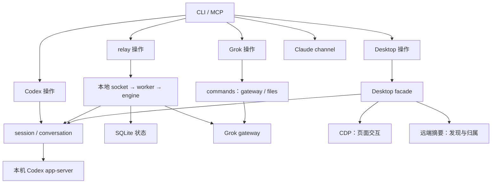

# 顶层架构与模块代码审查

日期：2026-11-16。基准：`a1b1997d16ec7c03e20924c665d193ffd6aa88df`。

这是修复前的审查记录。后续实现与验证见 [opt 分支修复结果](05-fixes.md)。

结论：现有 CLI/MCP → 共享业务 → 外部协议/存储的分层值得保留。最有价值的优化是修正状态归属、删除重复读取和无用写入，暂不需要重写框架。安全与数据完整性问题优先于文件拆分和代码风格统一。

三位审查代理分别检查 core、Codex/relay、ChatGPT Desktop；主审检查 CLI/MCP、构建和跨层契约，并交叉复核隔离复现。第四位只读代理综合架构解释。此次新增审查文档，未修改产品源码或测试，未 commit、push 或发布；已有的发布与 fork 文档改动保留。

## 架构与设计判断

整体设计方向合理：CLI 和 MCP 提供入口，共享 core 负责操作语义，各适配器对接 Grok、Codex、ChatGPT Desktop 和 Claude。本项目的复杂度主要来自不同系统的会话、交付和生命周期约束；目前没有证据支持整体重写或引入更通用的后端框架。

最值得简化的是重复获取同一数据、处理阶段混用，以及短连接策略进入长期连接状态。已有问题说明这些局部职责需要收拢，不能据此认定全部防御都过度。

### 关键概念

- **操作入口**：CLI/MCP 多数共享 operation，统一输入解析、错误和结果；Grok manual send 仍有独立实现。
- **Grok 后端**：`commands.js` 在 gateway 和本地文件间选择统一接口。文件模式只管理配置，不提供实际发送和 transcript。
- **Codex session / conversation**：session 管连接及 RPC；conversation 管特定 thread 的订阅、发送、观察和交互。
- **relay worker**：独立进程持有连接、绑定和持久记录，使调用方退出后仍能继续交付。
- **Desktop facade**：合并 app-server、CDP sidebar 和远端摘要，形成可分页的统一视图。

### 如何运行

Grok 路径先选择后端。gateway 负责认证、受限 HTTP、重连和回执；文件后端同步修改 profile、settings 和 group。正文提取由 `transcript.js` 共用，展示和可选历史保存位于其下游。

Codex 普通发送可以使用短 session；需要等待、watch 或 steer 时进入 conversation。managed 操作通过本地 socket 交给 relay worker。engine 在发送前持久化 `sending`，恢复后对账，不把无法确认的提交直接重发。入站消息与 checkpoint 一起提交，回答按归属分组返回，防止丢读和重复回传。

Desktop 读取主要复用 Codex app-server；`app-server-fallback.ts` 的文件名容易误导。列表还合并 CDP sidebar 和远端摘要，通过 snapshot 保持跨来源排序和后续分页。打开、发送和等待依赖 CDP 当前页面，因此操作串行执行。远端摘要只能说明线程存在及归属，不能提供远端正文或发送能力。

### 从哪里开始读

| 关注点 | 入口与实现 |
| --- | --- |
| CLI/MCP、构建 | `src/cli/`、`src/mcp/`、`agent-bundle.config.ts` |
| Grok、文件配置 | `src/core/commands.js`、`gateway.js`、`store.js` |
| Codex 连接与会话 | `src/core/codex/routes.ts`、`conversation.js`、`src/core/codex-bridge.js` |
| 持久转发 | `src/core/relay/`：managed → control/worker → engine → intake/completion/state |
| Desktop | `src/core/chatgpt-desktop/`：routes → facade → app-server/CDP |
| Claude、本机安装桥接 | `claude-channel.js`、`desktop-shim.js`、`desktop-shim-bridge.js` |

### 简化时的注意点

1. **一次获取，派生多个结果。** Desktop hosts 共用一份 inventory；Grok 名称解析和成员更新复用本次 roster。先消除重复 I/O，无需新增跨进程缓存。
2. **让处理顺序明确。** 完整 metadata 用于合并和搜索，输出时再压缩；DOM 去重交给已有评分规则；小回执路径跳过不用的正文构造。
3. **按生命周期划分状态。** one-shot 自动 refusal 策略不应使长期 transport 累积永久历史。优先消除这种耦合，单纯拆大文件收益有限。

必须保留 credential 目的地限制、脱敏、RPC 和结果预算、明确错误码下的兼容回退、草稿与线程归属校验，以及交付未知时不自动重发。relay 的 engine 队列维护交付状态机，state 队列维护持久化提交；它们职责不同。Desktop 的串行队列保护唯一 composer，也不能直接删除。

性能方面已确认重复 inventory、重复目录扫描和无用途正文构造；relay 还存在慢观察阻塞新提交的调度风险。调用次数和期限之和不能换算成实际提速或生产延迟，应先修局部浪费，再测真实负载。

## 优先处理的问题

以下是 20 项主要可执行发现：17 项安全或行为问题、2 项确定存在的多余工作、1 项测试环境隔离问题。编号对应分区报告，全部仍为 **待修复**。P1 应优先处理；P2 表示常规修复；P3 为较低优先级。优先级不能替代触发条件和证据范围。

| 编号 | 级别 | 问题及影响 | 证据 |
| --- | --- | --- | --- |
| Core-C1 | P1 | 多 cookie 的错误文本脱敏不完整，后续 cookie 值仍可进入日志或工具结果 | 合成 header 经两次公共脱敏仍含明文 |
| Core-C2 | P2 | CLI bot/transcript 输出保留外部 terminal controls | 实际构建 CLI 的捕获 stdout 含 OSC52 |
| Core-C3 | P2 | 合法 JSON 的 content 数组可让 `entryText` 抛错，影响 CLI/MCP/relay | 真实共享函数抛 TypeError |
| Core-C4 | P2 | 仅改 notify/hidden 也回写旧 profile，覆盖并发编辑 | mock 并发修改被覆盖，记录完整 RPC 顺序 |
| Core-C5 | P2 | settings 解析失败被视为空设置，更新静默丢失原数据 | 临时损坏 JSON 被覆盖成单字段 |
| Core-C6 | P2 | 原地写 JSON 失败会毁掉上一份完整配置 | 临时文件注入部分写入及 ENOSPC |
| Relay-C1 | P2 | 已解决请求累积进 refusal 历史，长期连接第 129 次交互被关闭 | 假 app-server 连续解决 129 次请求 |
| Relay-C2 | P2 | resolved 通知没有 thread ID，被过滤后残留幽灵交互 | 真实 conversation 仍报 waiting-for-input |
| Relay-C3 | P2 | conversation 丢弃规范化 ID，bridge start 的 `local:t` 路径失败 | 假服务器收到前缀 ID，返回 bare ID 后报错 |
| Relay-C4 | P2 | shim 将路径直接插入 Bash/plist，合法特殊字符被当代码或破坏 XML | 临时路径的命令替换被执行；非远程攻击复现 |
| Relay-C5 | P2 | 无 shim 安装归属时卸载仍清理 operator 的 GUI 环境变量 | fake runner 中自有环境值被删除 |
| Desktop-D2 | P2 | 搜索前截断 metadata，远端/CDP 长标题尾部匹配丢失 | 真实 facade 的尾部 query 返回零条 |
| Desktop-D3 | P2 | app-server 正常空列表被误报为双后端不可达 | 成功空列表与不可达 CDP 的组合断言 |
| Desktop-D4 | P2 | DOM 提前去重，丢失同 ID 后续行的 selected/pinned | 真实页面表达式与 Node 提取组合复现 |
| Desktop-D5 | P2 | MCP 外层期限短于允许的 open/send 等待 | 真实 runtime 序列与虚拟时钟断言 |
| Surface-S1 | P2 | transcript 总预算耗尽后仍累加 metadata，突破声明预算 | 输入小于 2 MiB，输出内容 307,400 > 200,000 字符 |
| Surface-S2 | P2 | 普通 send 输出把 unknown 投递写成 Sent | 实际 CLI：JSON unknown，普通输出 Sent |
| Desktop-D1 | P2 | hosts 对同一 inventory 重复读取 | 50 条 fixture：5 次分页 RPC、2 次 CDP 读取 |
| Surface-S3 | P3 | 默认小回执先解析全部正文，随后丢弃结果 | 活跃调用路径确认；无耗时测量 |
| Surface-S4 | P3 | history 测试继承 CODEX_THREAD_ID，误判合法来源前缀行为 | 设置该变量后已有测试按预期失败 |

安全、数据损失项应先修：Core-C1、C2、C4–C6 和 Relay-C4、C5。之后修 Codex 交互生命周期、Desktop 结果与期限，再整理多余计算。上述条目都能用现有共享函数或明确的模块所有权修复，不需要新增通用框架。

### 需保留限定的风险

- **Core-C7**：同一 gateway session 的共享 refresh 受第一个调用者取消影响，隔离复现成立；尚未找到内置 CLI/relay 稳定触发跨调用者取消的路径，列为 P3 API 隐患。
- **Core-C8**：direct gateway 将 408/499 归为 rejected，backend 则为 unknown。分类差异已证实，供应商是否保证未执行仍未知；不能断言远端已收到或必然重复发送。
- **Relay 慢 history**：engine 在同一队列内等待 completion。20 个 fake turns 触发 40 次串行 wait，每次允许 2 秒；80 秒只是允许时限之和，**不是实测耗时**。真实 anchored wait 常可立即返回，是否阻塞到 45 秒 control deadline 需另做负载验证。
- **relay 容量与保留期**：旧 records 与 binding 占用有界状态，但它们还承担重复抑制。先定义可安全归档的条件，不能直接清理旧 ID。

## 精简与效率改进顺序

| 批次 | 最小改动方向 | 必须一起验证的行为 |
| --- | --- | --- |
| 1：保护凭据与本机状态 | 修公共 cookie 脱敏、CLI 文本清理、严格 settings 写前读取、同目录临时文件替换、shim 引用与归属 | 多 cookie/多行、正常换行、坏 JSON 不覆盖、失败写保留旧文件、非自有环境不动 |
| 2：修状态与结果契约 | 跳过开关更新的 profile RPC；分离 pending 请求与一次性 refusal；消费 resolved；采用统一 ID；修空列表、搜索顺序、重复 DOM 去重、期限和输出 | 并发 profile 更新、超过 128 次已解决交互、foreign request 不串线、bridge local ID、分页/游标不漏项、unknown 不谎报成功 |
| 3：删除重复工作 | hosts 共用一次 inventory；files 组修改共用一次 records；小回执延后正文构造；隔离测试环境 | 来源失败 warning、零 thread host、成员规则、回执输出保持一致；用调用计数证明减少工作 |
| 4：再评估拆模块 | 从 Codex transport 移走 one-shot 策略；共享 global-state 解析；必要时分出 gateway 纯 roster 规则 | 先迁移活跃调用者，再删旧实现；不增加注册器、插件体系或缓存框架 |

另外已确认：files 为 3 个已知 UUID 设置组成员时扫描完整目录 6 次；这支持复用一次 records 快照。hosts 的 50 条样本可由 2 个分页 RPC 与 1 次 CDP inventory 得到所需信息。两者都是操作数证据，没有测真实服务延迟，不承诺加速百分比。

`desktop-shim.js` 的未使用 `codexHomeDir`、重复 stat 和过时注释可随相关修复顺手清理。Python bridge 从模板字符串移到独立文件需要先确认构建打包支持，不列为先决条件。history 数据库、通用 pipeline、跨进程 roster 缓存目前没有收益证据。

## 不应以“过度防御”为由删除的行为

- 凭据目的地校验、禁止 redirect、active account 绑定、跨平台解密和错误脱敏。
- 不确定投递不盲目重发；持久化 sending、稳定 client ID、游标与 record 一起提交、intentional duplicate suppression。
- Desktop 单一 composer 的操作串行化、草稿保护、project/会话核对、temporary/durable ID 区分。
- RPC frame 与 MCP result 的不同预算、lossless continuation、明确错误码触发的兼容回退。
- 输入 schema、外部协议解析和输出预算各自的边界；两个真实 backend 共用的 `commands` 适配。

未发现需要独立提交的大规模格式化或注释清理。文件较长和校验较多本身不是缺陷，拆分应减少状态归属或业务规则的重复。

## 覆盖、验证与详细证据

手写 `src` JS/TS/TSX 共 123 个文件、15,488 行，不含生成 bundle。模块内部深度与抽样边界见各报告；CLI/MCP 全部检查依赖关系，关键路由逐行审查，未声称逐行审计所有 schema。

| 分区报告 | 主要范围 |
| --- | --- |
| [01：core](01-core.md) | gateway/auth、files CRUD、transcript、history、URL policy、审批 |
| [02：Codex/relay](02-codex-relay.md) | transport、conversation、managed worker、SQLite 状态、shim、Claude channel |
| [03：ChatGPT Desktop](03-chatgpt-desktop.md) | 全部 16 个 Desktop 模块及 CLI/MCP 调用边界 |
| [04：CLI/MCP/build](04-surfaces-build.md) | route/输出契约、预算、测试运行环境、构建与发布配置 |

完整功能基线：`env CODEX_THREAD_ID= npm test`，**546 个 Node 测试与 97 个 route 测试全部通过**。该变量被清空是为隔离已发现的 Surface-S4；带合成变量的单独测试确实失败。分区测试与完整运行重叠，不重复累加数量。

主审读过隔离 fixture，并独立重跑 core、Codex/relay、Desktop 及 CLI/预算复现。测试仅使用合成凭据、临时数据、mock 或本机 loopback 假服务器。详细报告保留源位置、触发条件、最小修复建议与命令；临时复现脚本不属于永久回归测试，修复时应将对应行为纳入项目测试。

基线全绿表示既有契约通过，并不覆盖新增反例。此次没有访问真实 Desktop/CDP、生产网关或远端主机，没有发送真实消息，没有改用户安装和环境，也未做真实延迟、CPU、内存峰值或掉电恢复测量。报告中的性能结论限于确定的工作量与控制流。
