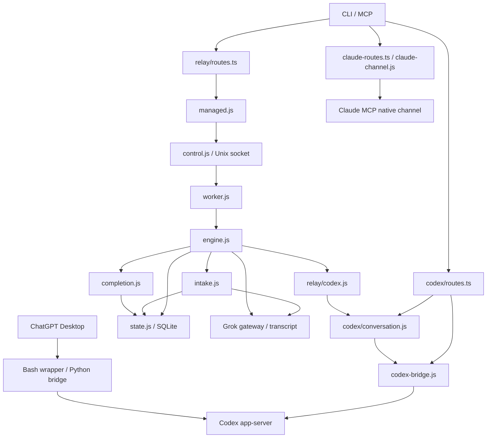

# Codex、relay 与本地 Claude channel 架构审查

目标是说明当前模块如何协作，找出可删除的复杂性、实际错误和运行成本。审查基线为 `a1b1997d16ec7c03e20924c665d193ffd6aa88df`。本次没有修改产品代码、测试、安装配置或现有未提交文档。

结论为 **ISSUES**。本地隔离实验确认五个行为问题。另有一个慢历史请求造成的串行阻塞风险，以及两个需要设计决定的简化方向。没有把文件长、校验多或重复抑制本身算作错误。

## 模块如何协作

CLI 与 MCP 大部分调用同一组 operation，核心有三条路径。



普通 Codex send 可以只开一次 session。wait、watch 和显式 steer 使用 conversation。managed send 则交给独立 worker，CLI 或 MCP 退出后 worker 继续工作。`engine.js:164` 在发送前持久化 `sending`，重启后通过 client ID 对账，不重发不确定的提交。

Grok 入站的 checkpoint 属于 target。`intake.js:82` 先收集整页 nonce，再区分 tracked reply、自己发出的 return 和绑定的普通消息。`intake.js:218` 把新 record 与游标一起提交。Codex 回答按 target、thread、turn、returnToGrok 分组，`completion.js:79` 为一次返回生成稳定 ID，再原子标记本组完成。

状态分工如下。两层队列负责不同约束，不能直接合并。

| 所有者 | 状态与生命周期 |
| --- | --- |
| `worker.js`、`ownership.js` | 独占 SQLite 锁、control socket、客户端集合、2 秒 tick。worker close 释放锁与 socket。 |
| `engine.js` | durable send、binding、tick 的串行队列；全局取消信号、binding 取消信号、停止集合。status 和 respond 不排入这个队列。 |
| `state.js` | SQLite snapshot、revision、提交队列、schema、容量限制。这里串行的是持久化修改，不含网络等待。 |
| `relay/codex.js` | 一代 app-server session、重连退避、conversation cache、InteractionRegistry。连接断开使交互身份失效。 |
| `codex/conversation.js` | thread 订阅、4 MiB 或 500 条事件窗口、accepted turn 集合、wait 与 watch。共享 session 时 close 只取消自己的订阅。 |
| `codex-bridge.js` | WebSocket 连接、请求关联、pending server request、一次性发送的 refusal 策略、thread discovery 与错误文档。最后两项与传输层混在同一模块。 |
| `claude-channel.js` | 一个显式命名的 live channel、最多 32 个 socket、临时 request ID。没有持久化或自动重试。 |
| `desktop-shim.js` | 安装生成物及 macOS GUI 环境。Python bridge 只转发现存 daemon 的协议，不拥有 daemon 的业务状态。 |

## 已复现的问题

### C1 · P2 · 已解决的交互仍会耗尽永久 refusal 历史

`src/core/codex-bridge.js:495` 同时用 `serverRequests.size`、`refused.length` 和 deferred 长度作为连接上限。`codex-bridge.js:522` 把每个 server request 放进 `refused`，即便显式 listener 已同步响应它。`codex-bridge.js:532` 处理 `serverRequest/resolved` 时只清 pending 和 deferred，从不清历史。于是限制从“最多 128 个未决请求”变成了“这个连接一生最多见过 128 个请求”。

活跃调用链是 managed operation → worker → engine → `createRelayCodex.connect` (`relay/codex.js:34`) → `openCodexSession` → `connectCodexAppServer`。长期 channel 和 relay 会走到这个连接，不只 one-shot send。

隔离 fake app-server 连续发送 129 个请求，每个请求都由客户端响应，再发送 resolved 通知。前 128 个均已完成，第 129 个使连接关闭，错误为 `Codex remembered server request limit exceeds 128`，`client.refused.length` 为 128。这个实验没有并发积压。连接关闭还会使其他 thread 的交互和观察一起失效。

最小修复是只给 one-shot refusal 策略保留它需要的有界历史。持久 session 只需要未决请求 Map，不应累计无关历史。保留 pending、deferred、listener 和字节预算。不要简单删除所有限制。回归测试应重复解决超过 128 次交互，并确认第 129 次仍可响应。

### C2 · P2 · resolved 通知在按 thread 过滤时被丢弃

`src/core/codex/conversation.js:65` 要求每个通知的 params 带当前 thread ID，才调用 record。`serverRequest/resolved` 的现有协议使用 requestId，仓库自己的 `test/codex-session.test.js` 也覆盖这种形状。`conversation.js:115` 明明有删除 resolved interaction 的逻辑，但只有 requestId 的通知到不了这里。`relay/interactions.js:30` 的同类删除也收不到该通知。

活跃调用链包括 CLI/MCP wait → `openCodexConversation.wait`，以及 relay → conversation 的 onEvent → InteractionRegistry。用户在原 Codex UI 解决请求后，这里仍可能显示旧请求。respond 会尝试一个传输层已删除的 request ID，返回失败。重复次数多时，registry 中的幽灵请求还能触发 100 项 overflow。

隔离实验在 thread/resume 后发送 `ask` approval，随即发送 `{method: 'serverRequest/resolved', params: {requestId: 'ask'}}`。历史保持 turn inProgress，wait 返回 `waiting-for-input`，交互列表仍含 `ask`。传输层已处理同一 resolved 消息。

最小修复是让 resolved 通知按本 conversation 已观察的 request ID 关联，再删除它。也可以把未决请求与 resolved 生命周期集中在 session 层，让 conversation 订阅有归属的交互。保留 foreign request 的静默行为。不要把无 thread 的所有通知都当成本 thread 的消息。

### C3 · P2 · conversation 丢掉规范化后的 thread ID

`src/core/codex/conversation.js:43` 调用 `conversationId(threadId)` 但不使用返回值。该函数在第 10 行委托 `normalizeCodexThreadId`，会把 `local:t` 变成 `t`。后续第 67 行的事件比较和第 81 行的 thread/resume 仍使用原字符串。相比之下，`codex-bridge.js:1317` 和 `codex/routes.ts:10` 都使用了规范化结果。

普通 CLI send 的 schema 已处理这一步，所以不能声称所有 Codex send 都失败。但 `relay/routes.ts:16` 的 bridge start thread ID 只是普通字符串，`engine.js:142` 也没有规范化。`gbot codex bridge start --codex-thread-id local:t`、对应 MCP operation 和直接调用 conversation 都走到错误路径。

隔离 fake app-server 接收到的 thread/resume 参数是 `local:t`。即使服务器返回正确 bare ID `t`，conversation 仍报 `thread/resume returned a different thread ID`。如果服务器拒绝 prefixed ID，会更早失败。

最小修复是 `threadId = conversationId(threadId)`，并让持久化 route 也使用统一的 bare ID，避免 binding 保存 local ID 而 send receipt 使用 bare ID。复用现有 normalizer，不再建立一种 ID 格式或宽松 fallback。增加从 bridge route 到真实假服务器的 local-ID 用例。

### C4 · P2 · 生成 Bash 和 plist 时把文件路径当作代码插入

`src/core/desktop-shim.js:99` 到 104 行、180 到 183 行把 install path 直接插入双引号字符串。`CODEX_HOME` 或 HOME 中合法的 `$()`、反引号、双引号和反斜杠会在运行生成脚本时被 shell 再解释。`desktop-shim.js:224` 又把同一路径未经 XML escaping 插入 plist，含 `&` 或 `<` 的路径使 plist 无效。

活跃调用链是 CLI desktop-shim install → `installDesktopShim` (`desktop-shim.js:285`) → renderWrapperScript/renderEnvScript/renderPlist → Desktop 启动 wrapper 或 launchd 执行登录脚本。环境覆盖值在运行时直接赋给变量本身不会再次进行命令替换，问题限定在渲染进脚本的默认值。

隔离实验令 realPath 含字面 `$(touch /private/tmp/.../marker)`，然后只以 `--version` 执行生成 wrapper。marker 被创建，证明路径字符被当成 shell 指令执行。没有运行真实 Codex、launchctl 或 daemon。这里没有证明外部攻击者能控制 operator 的安装路径，因此不把它升级成远程执行漏洞。

最小修复是在生成边界使用 shell literal quoting，让默认路径先赋给独立变量，再引用变量进行 `${override:-$default}` 选择。plist 使用 XML escaping。检查 Bash 和 XML 两种格式，不新增通用模板框架。含 `$`、引号、`&` 的临时安装路径足以形成回归测试。

### C5 · P2 · 没有安装也会清除 operator 的 GUI 环境

`src/core/desktop-shim.js:345` 的 uninstall 无论文件是否存在、GUI 当前值是否指向 shim，都在第 375 到 384 行 unset `CODEX_CLI_PATH`、`CODEX_HOME`、`CODEX_APP_SERVER_USE_LOCAL_DAEMON` 和 `CODEX_APP_SERVER_WS_URL`。最后一项甚至是安装主动 unset 的值。当前操作并不具有“只撤销自己写入的设置”的归属判断。

活跃调用者是 CLI desktop-shim uninstall (`src/cli/codex/desktop-shim.tsx:67`)。用户从未安装此 shim，或安装后改为自己的 wrapper，再执行 uninstall，仍会丢掉自己的 GUI 配置。这里只修改 launchd 的环境，不删除 Codex 的 durable data。

隔离 runner 以 Map 模拟 launchctl，预置 operator 的 CODEX_HOME、CODEX_CLI_PATH、WS_URL。使用全空临时安装目录调用 uninstall，三个 operator 值全部被删除。实验没有调用真实 launchctl。

最小修复先读取当前 GUI 值，只撤销仍属于本 shim 的配置。若继续承诺完整恢复 install 之前的环境，就需要在安装前保存原值并在归属匹配时恢复。至少让没有 owned install 的 uninstall 成为 no-op。不可用更宽的 rm 或重置整个环境来简化。

## 串行等待风险有调度证据，尚未复现真实 45 秒 control 超时

`src/core/relay/engine.js:113` 把整个 tick 和新 send 排入同一个 queue。tick 在第 326 与 342 行调用 completion 两次。`completion.js:41` 顺序等待最多 20 个独立 turn，`relay/codex.js:217` 为每个 wait 给 2000 ms。control 的客户端与 worker socket 都只有 45000 ms，见 `relay/control.js:7` 和 `relay/worker.js:128`。

注入 conversation 的隔离实验创建 20 个不同的 accepted turn，然后并发排入 tick 与一次新 send。记录到 40 次 wait、最大并发 1、每次传入 timeoutMs 2000，新 send 排在第 40 次 wait 后。40 个 wait 如果都消耗完整观察期限，允许等待总和为 80 秒，还没有算 reconciliation、Grok polling 和持久化。

这个数字是期限之和，**不是实测生产延迟**。实际 anchored conversation 在非终态历史快速返回时，会在 `conversation.js:177` 提前返回 unknown，不能把“20 个活跃 turn”直接等同于“80 秒”。触发条件是历史请求变慢或停滞，使多个 wait 用完 2 秒期限。没有在本次审查里等待真实 80 秒或跑真实 daemon 负载。

建议先把同一 tick 内独立的 completion 观察并行收集，然后仍以受控方式提交结果，或让每轮共享一个观察总期限。不能直接把所有 submit、intake 和 state transition 全部 Promise.all，否则会破坏 cursor、returnId 和重复抑制约束。最小可核实的后续实验是给假服务器历史响应设慢速，再用 control socket 证明新 send 不会越过 45 秒。

## 可以删除的概念与边界

`codex-bridge.js` 同时承担低层传输、one-shot refusal ownership、thread discovery、status、envelope 和发送策略。C1 是把 one-shot 生命周期放进 persistent transport 的具体后果。优先将自动 refusal 策略收回 one-shot sender，让 transport 只管理未决 RPC 与连接。这样能删掉长期连接的历史、expectedThreadId、expectedTurnId、deferred/adoptTurn 耦合，而不是仅把 1476 行搬成多个文件。保留 one-shot 拒绝外来审批的 ownership 检查。这个重构方案尚未实现或验证。

`desktop-shim-bridge.js:34` 把完整 426 行 Python 程序压在一个 JavaScript 字符串里。Python 的 read_frame、read_message、deadline 和两线程清理都要在生成后才有正常行号。本次通过导出 BRIDGE_SOURCE 到临时 bridge.py 才逐段检查。若打包工具可携带普通静态资源，单独维护 Python 文件、安装时复制同一文件，可以删除字符串转义这一层。是否支持静态资源需要先核实，当前仅是方案，不能直接删除 JS 导出并假设 artifact 会携带 Python。

`state.js:90` 固定最多 100 bindings 和 1000 records，且 operation 只支持 upsert。`state.js:246` 的 compact 压缩的是状态事件日志，不会移除已完成业务 record。`stopBinding` 也保留 binding，因此容量按历史累计。源码能确认这是生命周期限制，但本报告不把它当成可以直接 prune 的垃圾。旧 record 同时承担 request ID 幂等、nonce correlation、return 抑制。后续应明确永久保留哪些身份、哪些 payload 可以归档，再考虑缩减存储。删除整个 state、只保留最后 N 条或放大上限都会改变交付语义。

## 覆盖与保留意见

以下模块均逐段阅读。入口检查以调用关系、schema 复用和生命周期为主，没有复制每个 route 的 JSON schema 到报告。

| 范围 | 阅读结论 |
| --- | --- |
| `codex/contract.js`、`thread-id.js` | 退出码与 ID normalizer 有明确共享价值。receipt 与 thrown error 的分流应保留。 |
| `codex/conversation.js`、`remote-control.js`、`routes.ts` | 发现 C2、C3。remote-control 的多形状解析是外部持久格式兼容；未证明任何分支可删。 |
| `relay/profile.js`、`managed.js`、`control.js` | profile 隔离、worker checksum、connected mutation 不重试都应保留。 |
| `relay/ownership.js`、`state.js` | 单 worker lifetime lock 与 state transaction 各有职责。symlink、owner、mode、corruption、revision 和容量检查应保留。 |
| `relay/engine.js`、`intake.js`、`records.js` | route、intent 与 checkpoint 关系清楚。存在网络等待占用 mutation queue 的风险。nonce 全页收集与原子 intake 必须保留。 |
| `relay/codex.js`、`completion.js`、`interactions.js` | session generation、guarded steer 和 return 分组有必要。独立观察串行化可以改，身份校验不能简化掉。 |
| `relay/detail.js`、`routes.ts` | 错误长度控制与 CLI/MCP 共用 operation 合理。answerSchema 与 registry 的答案长度上限不同，外层可通过的内容内层可能拒绝，但尚未形成优先问题。 |
| `codex-bridge.js` | 全文件阅读。发现 C1。thread/list 缺少与 history visitor 相同的 repeated-cursor 保护，属于未实验的协议异常风险，没有升级为已证实问题。 |
| `desktop-shim.js`、`desktop-shim-bridge.js` | 发现 C4、C5。pristine stdio 才允许 fallback、first RPC deadline、mid-session write deadline 与 idle read 的区别应保留。 |
| `claude-channel.js`、`claude-routes.ts`、`mcp/claude-channel.ts` | 真实本地 request/reply 测试通过。directory/socket 权限、上限、超时以及 sent 后 unknown 不重试是明确边界。没有高置信度新增问题。 |
| CLI、MCP 与脚本入口 | 检查 Codex send/wait/watch/list/new/queue、bridge start/status/respond/stop/run、desktop-shim、grok send、`src/scripts/gbot-relay.ts`。managed 与前台 worker 生命周期分开是有意行为。 |

comment-sicko 检查没有进行批量注释删除。`desktop-shim.js:34` 的 `codexHomeDir` 没有调用者，可以删除。`isExecutable` 在第 259 与 265 行重复 stat，也只需一次。`codex-bridge.js:1150` 的 threadState 前注释仍声称 gbot never steers，和第 1386 行显式 steer 路径冲突，应删除旧叙述或把注释限定为 reject 策略。它们属于低成本整理，不与五个行为问题同级。

没有核实最新版 Codex 或 ChatGPT Desktop 的外部实现，所以关于其 startup、proxy、local prefix 等外部约束的解释保留为 HOLD。现有本地假服务器可以验证本仓库的假设一致性，不能证明今天的上游实现仍相同。未据此建议删除协议兼容或 fallback 保护。

## 验证记录

环境为 Node `v26.13.1`。所有新实验只使用 `/private/tmp/gbot-audit-codex-relay` 下的临时文件、假的本地 Unix socket、注入的 session、gateway 或 runner。没有读取真实 auth、Codex global state 或 operator 配置，没有发送真实消息、运行 daemon 命令、安装远程内容或进行 Git 写操作。

以下现有测试在允许临时 socket 的权限下通过，共 229 tests、0 fail、0 skipped。原始日志为 `/private/tmp/gbot-audit-codex-relay/baseline-unsandboxed.log`。第一次同一命令在 sandbox 中被 Unix socket 的 EPERM 阻止，随后原样重跑。EPERM 没有计作产品缺陷。

```sh
GROK_BOT_TEST=1 TMPDIR=/private/tmp/gbot-audit-codex-relay node --test \
  test/codex-contract.test.js test/codex-conversation.test.js \
  test/codex-session.test.js test/relay-codex.test.js \
  test/relay-completion.test.js test/relay-interactions.test.js \
  test/relay-state.test.js test/relay-engine.test.js \
  test/relay-lifecycle.test.js test/relay-auth-recovery.test.js \
  test/relay-gateway-lifecycle.test.js test/relay-worker.test.js \
  test/relay-failure-detail.test.js test/desktop-shim.test.js \
  test/desktop-shim-startup.test.js test/claude-channel.test.js
```

新实验保存在 `/private/tmp/gbot-audit-codex-relay/repro.mjs` 与 `resolved.mjs`。前者检查 C1、C3、C4、C5 和 completion 调度，后者检查 C2。执行方式如下，两条均 exit 0。脚本中的 assertions 断言缺陷当前存在，因此不能把通过理解为产品已修复。

```sh
GROK_BOT_TEST=1 TMPDIR=/private/tmp/gbot-audit-codex-relay \
  node /private/tmp/gbot-audit-codex-relay/repro.mjs
GROK_BOT_TEST=1 TMPDIR=/private/tmp/gbot-audit-codex-relay \
  node /private/tmp/gbot-audit-codex-relay/resolved.mjs
```

关键输出如下。

```text
resolved-approvals: requests=129, closed=true, historicalRequests=128
local-prefix: sentThreadId=local:t, error=thread/resume returned a different thread ID
shell-path-expansion: markerCreated=true
uninstall-without-owned-install: operatorEnvironmentLost=true
completion-serialization: waitCalls=40, maxConcurrent=1, requestedTimeoutMs=2000
resolved-notification-filtered: state=waiting-for-input, staleInteraction=ask
```

没有运行全仓库 build、typecheck、完整 `codex-bridge.test.js`、artifact CLI/MCP 全链路测试或真实 Desktop 与 daemon。没有 benchmark，也没有生产运行时数字。临时实验是可复跑的本机证据，仓库长期回归测试仍需在修复时加入。
